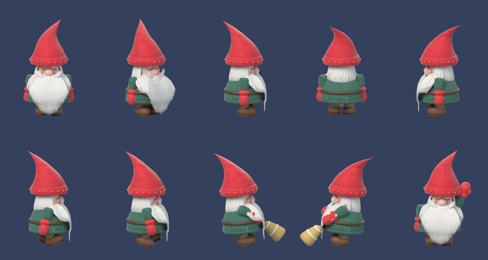
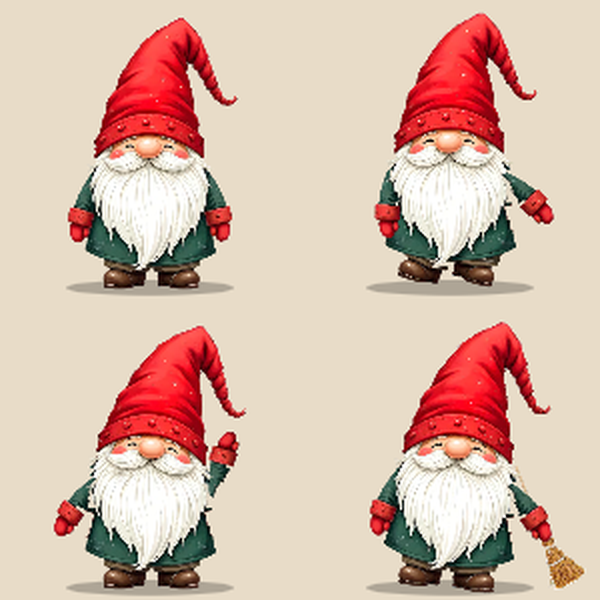
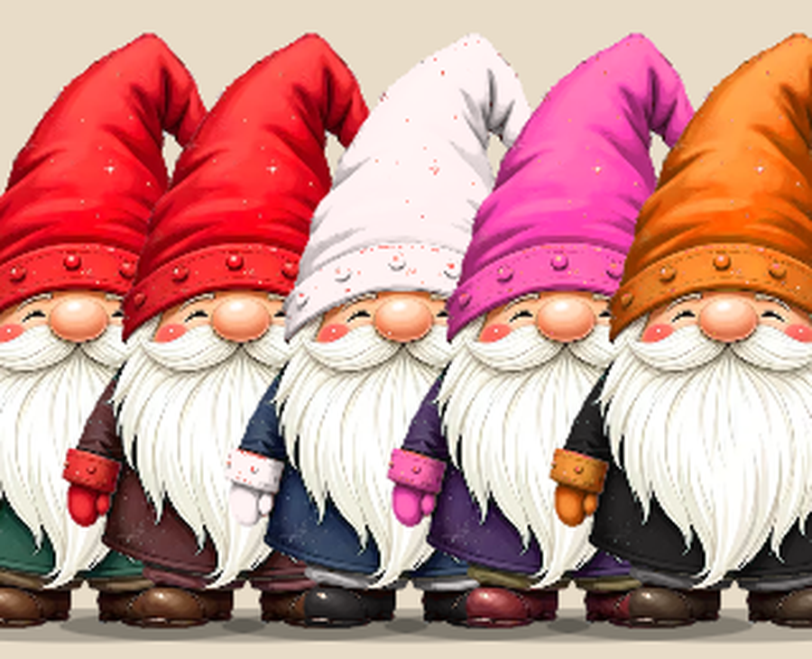
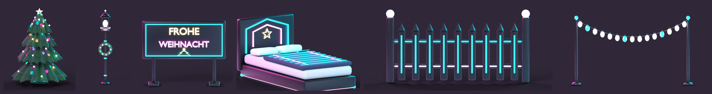
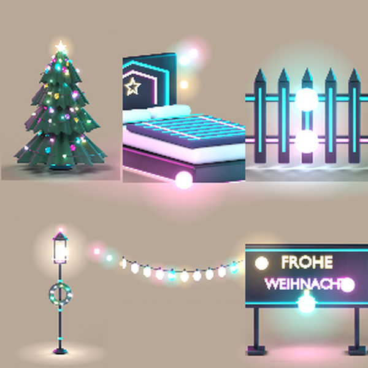
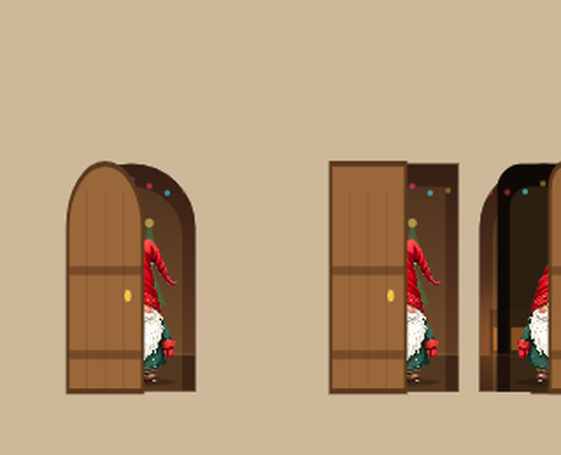
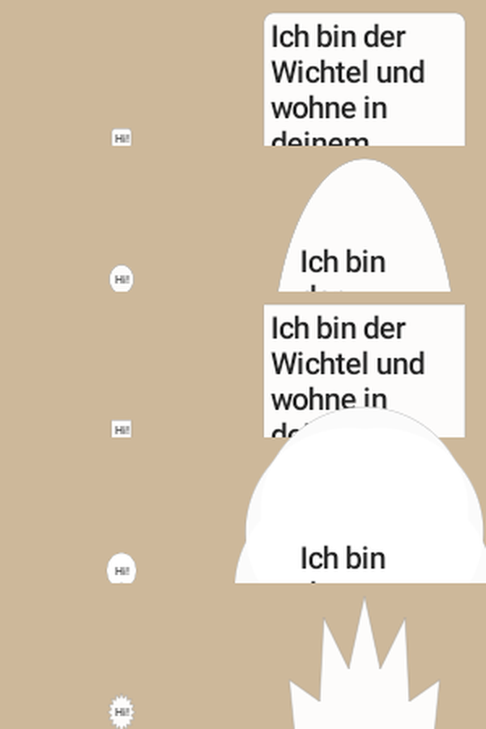

# Wichtelein 🧝

Eine Android-App für Kinder: Man filmt sein echtes Zimmer (oder fotografiert z. B. das Wichtelhaus), und danach kommt ein kleiner Wichtel ins Bild. Er läuft herum,
räumt auf, macht Chaos, tanzt, purzelt, stolpert, nascht Kekse, versteckt sich und spricht dabei – auch mit dem Namen des Kindes.
Am Ende gibt es ein fertiges MP4-Video mit Bild und Ton zum Speichern und Teilen.

Namen, Sprüche, Stimme, Farbe und die erlaubten Szenen sind frei einstellbar, die App ist nicht an ein bestimmtes Kind gebunden.

## Vorschau

Die Bilder sind echte Ergebnisse: die Wichtel und Gegenstände aus Blender, die Sprechblasen, Türen und der 2D-Wichtel aus den Emulator-Tests der CI.

**3D-Wichtel** – ein gedrungener Zwerg, in Blender modelliert (Bart, Schnurrbart und Haar aus über 2000 einzelnen Strähnen, Mütze mit Faltenwurf). Er dreht sich in Laufrichtung,
steht beim Fegen seitlich und winkt aus der jeweiligen Richtung (Stehen aus 16 Richtungen, Laufen, Fegen mit Besen, Winken).

**2D-Wichtel** – der Wichtel aus dem Referenzbild, in Kopf, Rumpf, Arme und Beine geschnitten und animiert; Mütze, Mantel, Hose und Schuhe sind umfärbbar.

| Referenz in Teilen | Posen (Stehen, Laufen, Winken, Fegen mit Besen) | Umgefärbt |
|---|---|---|
|  |  |  |

**Gegenstände im Bild (Cyberpunk-Weihnacht)** – Tannenbaum mit LED-Kette, Laterne mit Kranz, Neonschild, Bett, Zaun und Lichterkette. Jeder lässt sich einzeln platzieren,
verschieben, vergrößern, spiegeln, umfärben und mit oder ohne Licht zeigen; die Lichter blinken. Im Film stellt der Wichtel sie selbst auf.

| Im Bild (Neonlicht blinkt) | Tür mit winziger Weihnachtsstube |
|---|---|
|  |  |

**Sprechblasen** – pro Aktion an oder aus, in fünf Formen (Abgerundet, Rund, Viereck, Wolke, Zackig) und in der Größe einstellbar:

## So funktioniert es

0. **Kleidung:** In den Einstellungen lassen sich Mütze (und Fäustlinge), Mantel, Hose und Schuhe einzeln umfärben (11 Farben, Vorschau).
1. **Erster Start:** Ein Erwachsener gibt den Namen des Kindes ein (weitere Kinder später in den Einstellungen).
2. **Foto-Film (neu in 0.3.0):** Auf der Startseite „Foto-Film“ – Foto machen (oder ein Foto aus der Galerie wählen), zum Beispiel vom Wichtelhaus.
   Im Editor den Chip **🎯 Aktionen** öffnen, eine Aktion wählen (Fegen, Winken, Tanzen, Hinsetzen, Schlafen, Keks, Geschenk, Zaubern, Purzelbaum,
   Stolpern, Chaos, Verstecken, Verbeugen; mit markierter Tür auch Anklopfen, Ins Haus gehen, Aus dem Haus kommen, Vor der Tür fegen) und ins Bild
   tippen, wo sie stattfinden soll. Der Wichtel läuft die Aktionspunkte der Reihe nach ab; die Länge des Films ergibt sich automatisch.
   Ohne Aktionspunkte spielt er zufällige Szenen in einer einstellbaren Länge (6–40 s). Die Aktionspunkte gibt es auch beim Video.
   **Video aufnehmen** (Hoch- oder Querformat, bis 30 s, ohne Ton) oder **Video auswählen** geht wie bisher.
3. **Editor:** Startpunkt antippen, Größe einstellen, optional einen Weg aus bis zu 8 Punkten antippen, bei einem **Wichtelhaus** die Tür markieren (Position und Größe), Kategorie
   (*Braver Wichtel*, *Frecher Wichtel*, *Überraschung* oder Zufall) und gewünschte Szene wählen oder **neu würfeln**.
   Die Vorschau läuft sofort über dem Video, die Sprache wird passend zum Zeitpunkt abgespielt.
4. **Als Video speichern:** Fortschrittsanzeige, danach liegt das MP4 in der Galerie (*Filme/Wichtelein*) und unter
   **Meine Wichtelvideos** (ansehen, teilen, löschen).
5. **AR-Wichtel:** Auf der Startseite „AR-Wichtel“ öffnen, Boden suchen lassen, auf den Boden tippen – der Wichtel steht im echten Raum und spielt seine Szenen
   (nur auf Handys mit ARCore, siehe unten).
6. **Wichtelaktionen:** Hier lassen sich einzelne Szenen ein- und ausschalten.

## Was fertig ist, was nur Prototyp ist, was fehlt

**Umgesetzt und im Android-Emulator der CI geprüft** (26 Emulator-Tests und Unit-Tests, siehe unten):
- Startseite mit den fünf Bereichen, Namensabfrage beim ersten Start, Kinderprofile, Einstellungen, Wichtelaktionen,
  Meine Wichtelvideos (Darstellung), Editor mit Startpunkt, Größe, Weg, Szene und Würfeln.
- **Der Wichtel** (seit 0.3.0): ein Wichtel mit roter Zipfelmütze, weißem Bart und grünem Mantel, aus dem Bild `Wichtel_bild1` (vom Nutzer mit ChatGPT erzeugt,
  die Rechte liegen beim Nutzer) in Kopf, Rumpf, Arme und Beine geschnitten (`tools/asset/`). Der frühere Foto-Elf und der selbst modellierte 3D-Wichtel
  sind entfernt. Gelenk-Animation, Kleidungsfarben, Kopfnicken beim Sprechen; Mund und Augen verdeckt der Bart.
- **3D-Wichtel (seit 0.4.0, in den Einstellungen unter „Figur“ wählbar; die 2D-Figur bleibt):** komplett in Blender modelliert (`blender/wichtel3d.py`) und aus allen
  Richtungen gerendert. Er dreht sich beim Laufen in Laufrichtung (auf den Betrachter zu, seitlich, vom Betrachter weg), steht beim Fegen seitlich (mit Staubwolken
  am Ende jedes Besenstrichs) und dreht sich zum Haus um 360° mit dem Rücken zum Betrachter, bevor er die Tür öffnet und hineingeht. Winken, Fegen und Laufen
  sind echte Bilder aus der jeweiligen Richtung; Hinsetzen, Purzelbaum, Schlafen u. Ä. entstehen aus dem Stehbild. Farben: Mütze und Mantel.
- **Elfin mit eigenen Sätzen und Farben (0.9.3):** Die Elfin spricht komplett eigene Texte („Elfenstaub“, „Elfenstreich“ …), hat eigene Kleiderfarben, eigene „Eigene Sätze“ und im Editor einen eigenen Startpunkt.
  Aktionen können für den Wichtel, die Elfin oder beide zusammen gesetzt werden (bei „beide“ warten sie aufeinander). Antippen und Verschieben berücksichtigt die Drehung von Gegenständen und Tür.
- **Wichtel und Elfin zusammen (0.9.3):** Einstellungen → Figuren: nur der Wichtel, nur die Elfin oder beide. Bei beiden wählst du im Editor pro Aktion, wer sie macht; der Wichtel bekommt nur männliche,
  die Elfin nur weibliche Stimmen. Die Tür lässt sich wie die Gegenstände drehen. Die Einstellungen sind in aufklappbare Bereiche gegliedert.
- **Drehen, Schnee-Schalter, 3D-Elfin (0.9.2):** Jeder Gegenstand lässt sich um seinen Fußpunkt drehen (⟲ ⟳, Schieber); ein schräges Bett dreht den liegenden Wichtel mit.
  „❄ Schnee: an/aus“ im Editor lässt es von Anfang an schneien. Die Wichtelfrau gibt es jetzt auch als 3D-Figur (dreht sich, läuft, fegt, winkt).
- **Gegenstände klassisch oder Neon (0.9.1):** Tannenbaum, Zaun (Holz), Laterne, Lichterkette, Holzbett gibt es jetzt klassisch mit warmem Licht; die Neon-Gegenstände (Cyberpunk) bleiben als eigene Gruppe.
  Neu sind Schneemann, Geschenke, Schlitten, Zuckerstangen, Bank und Lagerfeuer. Betten sind seitlich zu sehen, der Wichtel legt sich quer hinein und die Bettkante liegt vor ihm.
- **Schnee (0.9.1):** Aktion „❄ Es fängt an zu schneien“ (setzt langsam ein) und „☀ Der Schnee hört auf“.
- **Aussehen der App (0.9.1):** wie das Handy, hell oder dunkel (Einstellungen).
- **Wichtelfrau (0.9.1):** In den Einstellungen kann statt des Wichtels die Elfin erscheinen (gezeichnete 2D-Figur mit Zipfelmütze, Zöpfen und Kleid, umfärbbar).
- **Ins Haus gehen und drinnen bleiben (0.9.0):** Aktion „🏠 Ins Haus gehen & drinnen bleiben“: Er geht zur Tür, öffnet sie, geht hinein (wird dabei etwas kleiner), dreht sich
  drinnen zum Betrachter um, winkt kurz und schließt die Tür von innen. Danach bleibt er im Haus, bis die Aktion „🚪 Aus dem Haus kommen“ (oder eine andere Aktion) ihn wieder herausholt;
  er kommt dann größer werdend heraus, dreht sich um und schließt die Tür. Auch als Szene „Ins Haus und drinnen bleiben“.
- **Lange Filme (0.8.1):** Viele Aktionen oder Gegenstände verlängern den Film; ist die Vorführung länger als das Video, wiederholt sich das Video, nichts wird abgeschnitten.
- **Sprechblase pro Aktion (0.8.0):** an oder aus (gesprochen wird trotzdem), Form (Abgerundet, Rund, Viereck, Wolke, Zackig) und Größe; Standard in den Einstellungen,
  eigene Blase je Aktion im Editor (Werkzeug „🎯 Aktionen“, Aktion auswählen).
- **Summen und Brummen (0.8.0, Einstellungen → Geräusche):** Ist die Stimme aus, brummt der Wichtel eine Silbe pro Wort. Ist sie an, summt er in den Pausen
  kleine Weihnachtsmelodien (O Tannenbaum, Jingle Bells, Stille Nacht) dazu – kombinierbar mit Stimme, Effekt und Geräuschen. „Psst“, „Schhh“, „Brrr“, „Hmmm“ werden nicht
  mehr buchstabiert („Psst“ ist ein leises Zischen).
- **Hintergrundmusik (0.8.0, Editor → „🎵 Musik“):** vier selbst erzeugte Spieluhr-Melodien (Schneeflocke – eine eigene Melodie –, O Tannenbaum, Jingle Bells, Stille Nacht)
  oder eine eigene Datei (z. B. MP3). Sie läuft in der Vorschau als Schleife, im Video mit einstellbarer Lautstärke, wiederholt sich und wird am Ende ausgeblendet.
- **Editor (neu in 0.5.0):** Alles Gesetzte (Start, Wegpunkte, Aktionen, Tür, Gegenstände) lässt sich antippen (auswählen), mit dem Finger verschieben und einzeln löschen;
  „↶ Rückgängig / ↷“ nimmt jeden Schritt zurück. Werkzeuge als Karten: Start, Weg, Aktionen, Tür, Objekte, Szene.
- **Gegenstände im Bild (Cyberpunk-Weihnacht, Neonlicht):** Tannenbaum mit LED-Kette, Kugeln und Stern, Bett, Zaun, Laterne mit Kranz, Lichterkette, Neonschild.
  Jeder einzeln wählbar, platzierbar, in der Größe änderbar, spiegelbar; der Wichtel läuft davor und dahinter vorbei. In Blender gerendert
  (`blender/szene3d.py`); die Lichter leuchten und blinken in der Vorschau und im exportierten Video (additive Leuchthöfe, Bodenschein).
- **Update-Fenster:** Die Update-Suche startet den Download nicht mehr sofort, sondern zeigt „Neues Update verfügbar“ bzw. „Du hast die neueste Version“ mit
  dem Änderungsprotokoll; der Download beginnt erst mit „Jetzt updaten“ (sonst „Abbrechen“).
- **3D-Wichtel überarbeitet:** gedrungener Zwerg mit Gürtel, großer Nase und Augenbrauen; Bart, Schnurrbart und Haar bestehen aus über 2000 einzelnen Strähnen,
  Mütze mit Faltenwurf, Stoffmuster aus dem Referenzbild.
- **Laufweg:** Der Wichtel bleibt in der Nähe der gesetzten Punkte (Start, Weg, Aktionspunkte) statt im ganzen Bild herumzuspringen; die Wegpunkte läuft er als
  Rundgang ab.
- **Besen** aus dem Besenfoto (`wichtel-besen-1`), freigestellt und in der Hand des Wichtels; beim Fegen schwingt er mit dem Arm.
- **Weihnachtsgeräusche** (seit 0.3.0, abschaltbar in den Einstellungen): Glöckchen beim Auftreten, Grüßen und Tanzen, leises Mützenglöckchen beim Laufen,
  Schritte, Besenstriche, Tür quietscht auf/fällt zu, Klopfen, Puff, Funkeln beim Zaubern, Plumps, Knuspern, Geschenkpapier. Alle Klänge werden von der App selbst
  erzeugt (`sound/SoundFx.kt`, keine fremden Klangdateien), laufen in der Vorschau live und sind im exportierten Video in der Tonspur gemischt.
- Aktionen: Laufen, Stehen, Winken, Fegen, Tanzen, Stolpern, Hinsetzen, Verstecken, Purzelbaum, Schlafen, Naschen, Chaos
  (Spielzeug werfen), Aufräumen, Zauber; Gegenstände: Besen, Geschenk, Keks, Spielzeug, Konfetti.
- **Tür-Optionen:** Anschlag **links oder rechts** (Türblatt schwingt zur gewählten Seite) und die Form von **eckig bis Rundbogen** per Regler.
- **Wichtelhaus-Tür:** Im Editor wird die Tür im Video markiert; der Wichtel öffnet sie (Türblatt schwingt auf, warmes Licht), geht hinein, schließt sie,
  kommt wieder heraus oder fegt davor (4 Türszenen, nur wenn eine Tür markiert ist). Die Tür wird als Overlay gezeichnet.
- **Kleidungsfarben** je Kleidungsstück (Mütze, Jacke, Strumpfhose, Schuhe), zur Laufzeit per HSV-Umfärbung der Bildteile.
- 19 Szenen in 3 Kategorien, die Auswahl variiert; jede Aufführung ist über einen Startwert reproduzierbar und lässt sich neu erzeugen.
- Über 30 kindgerechte Sprüche plus Szenensprüche, Platzhalter `{name}` und `{wichtel}`, eigene Sätze.
- Sprache und Bewegung kommen aus **einer** Zeitleiste und passen daher zusammen.
- Export als MP4 mit Bild (Wichtel über dem Originalvideo, Schatten) und Ton (Sprache, ggf. Originalton), Fortschritt, Fehlerdialog;
  getestet bis zum fertigen Video: Video- und Tonspur vorhanden, Wichtel im Bild – auch bei Videos, die wie Handyaufnahmen
  gedreht gespeichert sind (Hochformat als gedrehtes Querformat).
- Offline, kein Konto, keine Werbung, keine Tracker. Berechtigung nur für die Kamera; das Internet wird nur für die
  Update-Suche und optionale Stimmen-Downloads benutzt.
- Signierte Release-APK per GitHub Actions, Update-Suche in der App.

**Echtes AR (ARCore) – umgesetzt, aber nur kompiliert und auf Einbindung getestet, nicht auf einem Handy:**
- Bodenerkennung, Verankerung des Wichtels im Raum, Perspektive/Größe passend zur Entfernung, Szenen mit Sprache. Der Emulator der CI hat kein ARCore,
  deshalb ist die Kamera-/Boden-/Tracking-Logik (`ar/`) **ungeprüft**. Es braucht ein ARCore-fähiges Handy mit „Google Play-Dienste für AR“.
- Einschränkung: Aus dem AR-Modus gibt es noch keinen Videoexport (nur Live-Ansicht); Türszenen sind im AR-Modus abgeschaltet.

**Prototypisch / mit Einschränkung:**
- Der Wichtel ist eine **2D-Puppe aus Einzelteilen** (Frontansicht, wird gespiegelt), kein 3D-Modell: Beine, Arme, Körper und Kopf drehen sich um ihre Gelenke
  (Farben frei wählbar), dazu Kopfnicken beim Sprechen, Schatten. Das ist bewusst gewählt, weil es deutlich besser aussieht als ein selbst modelliertes einfaches
  3D-Modell. Die Bilder sind in `app/src/main/res/drawable-nodpi/`. Ein Blender-Versuch (Teile mit Textur gewölbt und gerendert, `blender/`) wirkte flacher in
  Farbe und Kontrast und wird deshalb nicht benutzt.
- Die Geräusche sind **synthetisch** (Klang aus Sinus und Rauschen) und klingen entsprechend einfach; wie gut sie wirken, kann nur der Nutzer beurteilen.
- Es gibt kein Tracking: Der Wichtel liegt als Overlay über einem Video, die Kamera sollte also ruhig stehen. Keine räumliche Erkennung.
- Im Export ist die Sprache der **Wichtelstimme** (offline) enthalten, geprüft im Emulator. Wird die **Systemstimme** gewählt, erzeugt die App
  die Sprache über `synthesizeToFile`; das ist umgesetzt und per Unit-Test des WAV-Einlesens abgesichert, konnte aber im Emulator
  nicht ausgeführt werden (kein deutsches TTS-Paket im Test-Image). Gelingt es nicht, zeigt das Video nur Sprechblasen und die App sagt es.
- Hoch-/Querformat-Aufnahme und das Abspielen über „Ansehen“/„Teilen“ sind implementiert, aber **nicht auf einem echten Handy getestet**
  (der Emulator hat keine brauchbare Kamera). Ebenso ist die **Klangqualität der Stimmen nur vom Nutzer beurteilbar**.

**Fehlt:**
- Vorgerenderte Blender-Animationsclips und echte 3D-Ansichten (Seite, Rücken): Der Wichtel hat nur die Vorderansicht. Die Figur ist über die Schnittstelle
  `ElfFigure` austauschbar (z. B. gegen ein Echtzeit-3D-Modell).
- Videoexport aus dem AR-Modus.
- Anpassbare Bewegungsabläufe pro Szene über die Wegpunkte hinaus; Mehrfach-Videos in einem Projekt.
- Weitere Kleidungsstücke (z. B. andere Mützen oder Schals) – bisher nur die Farben.
- Die Wichtelhaus-Tür ist ein gezeichnetes Türblatt über der echten Tür im Video; Aussehen und Farbe lassen sich noch nicht einstellen.

## Stimmen

Die Wichtelstimme ist ein neuronales deutsches Sprachmodell, das komplett offline auf dem Handy läuft
(Piper über sherpa-onnx, CC0/Apache-2.0). Eingebaut ist „Thorsten (mit Stimmungen)“. In den Einstellungen lassen sich weitere
Stimmen laden (Thorsten hoch, Miro, Dii, Ramona, Kerstin, Karlsson; Download von der offiziellen k2-fsa-Veröffentlichung, SHA-256-geprüft)
und mit „Stimme anhören“ ausprobieren. Der **Wichtel-Effekt** hebt die Tonhöhe dosiert an (0 = natürlich); Tempo und Stimmung sind einstellbar.
Fehlt das Modell, spricht die Android-Systemstimme, sonst bleiben nur die Sprechblasen.

## Technik und Aufbau

Kotlin, Jetpack Compose, CameraX, AndroidX Media3 Transformer, sherpa-onnx. Eine App, Aufgaben nach Paketen getrennt
(`dependabot.yml` schlägt wöchentlich Aktualisierungen der Abhängigkeiten vor):

| Bereich (Paket unter `app.wichtelein`) | Inhalt |
|---|---|
| `camera` | `CameraScreen.kt` (Aufnahme, Drehung), `PhotoScreen.kt` (Foto machen, Foto aufbereiten), `VideoInfo.kt` |
| `sound` | `SoundFx.kt` (selbst erzeugte Geräusche, Abspielen, Mischen für den Export) |
| `anim` | `ElfEngine.kt` (Aktionen, Takt), `ElfDrawing.kt` (Figur `ElfFigure`/2D-Puppe), `Performance.kt` (Aufnahme der Zeitleiste, Aktionspunkte `ScriptStep`/`ElfAction`), `ElfOverlay.kt` (eine Zeichenfunktion für Vorschau und Export) |
| `scene` | `Scenes.kt` (19 Szenen, Zufallsauswahl), `Texts.kt` (Sprüche, Platzhalter) |
| `speech` | `ElfVoice.kt`, `VoiceCatalog.kt`, `VoiceEffect.kt`, `Speaker.kt`, `SpeechRender.kt`, `VoiceUi.kt` |
| `videoexport` | `Export.kt` (Media3 Transformer, Galerie, Teilen) |
| `settings` | `Settings.kt` (Einstellungen, Profile), `Updater.kt` |
| `ui` | `HomeScreen.kt`, `EditorScreen.kt`, `SettingsScreen.kt`, `ActionsAndVideosScreens.kt` |
| Wurzel | `MainActivity.kt` (Navigation) |

Ablauf: Der Editor lässt die Engine mit einer virtuellen Uhr und festem Zufallsstartwert eine komplette Aufführung **aufnehmen**
(Bilder mit 30 fps + Sprach- und Geräusch-Ereignisse). Vorschau und Export spielen dieselbe Zeitleiste ab. Beim Foto-Film wird das Foto
(auf Full HD verkleinert, gedreht, gerade Seiten) als Standbild der Länge der Zeitleiste in den Media3 Transformer gegeben.

## Bauen

- Zuerst einmalig `bash tools/fetch-voice.sh`: lädt sherpa-onnx 1.13.8 (Version 2.x enthält die nötige Phonemisierung nicht mehr)
  und das eingebaute Stimmenmodell (SHA-256-geprüft) nach `app/libs/` und `app/src/main/assets/voice/`. Beides liegt nicht im Repository.
- Lokal: Android Studio öffnen oder `./gradlew assembleDebug` (JDK 17, Android SDK 35, mindestens Android 10).
- **GitHub Actions:** `android.yml` baut bei jedem Push die signierte Release-APK (Release `build-<Nr>`),
  `ci.yml` führt Unit- und Emulator-Tests aus (App starten, Szenen rendern, Stimme erzeugen, Stimmen-Download,
  Editor bis zum fertigen MP4 prüfen); Screenshots, Videobilder und WAV-Dateien liegen als Artefakt `emulator-screenshots` bei.

## Releases und Updates

- Die Build-Nummer ist der `versionCode`; jede neue APK lässt sich über die alte installieren.
- Signiert wird mit dem gemeinsamen Release-Schlüssel aus den Repository-Secrets `ANDROID_KEYSTORE_BASE64`,
  `ANDROID_KEYSTORE_PASSWORD`, `ANDROID_KEY_ALIAS`, `ANDROID_KEY_PASSWORD`. Der Schlüssel liegt nie im Repo.
- „Nach Update suchen“ fragt die öffentliche GitHub-Releases-API ab (ohne Token).

## Datenschutz

Videos, Namen und Einstellungen bleiben lokal auf dem Gerät. Persönliche Videos gehören nicht in dieses Repository
(`*.apk` und Schlüsseldateien sind in `.gitignore`).
